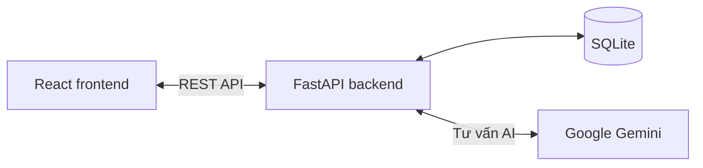
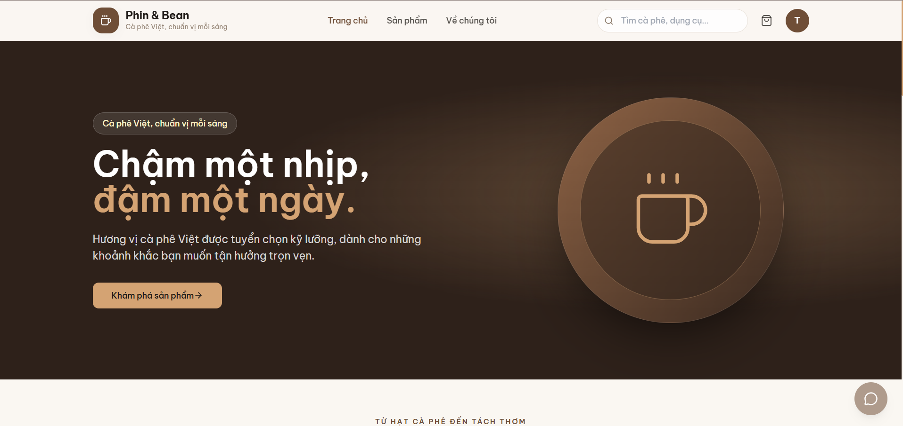
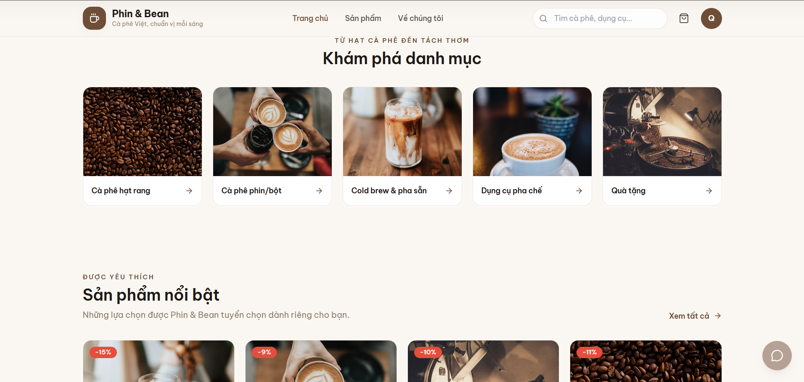
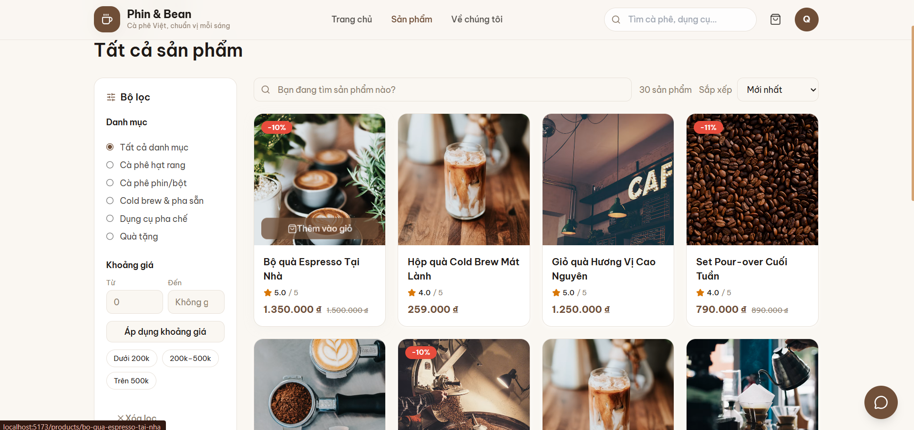
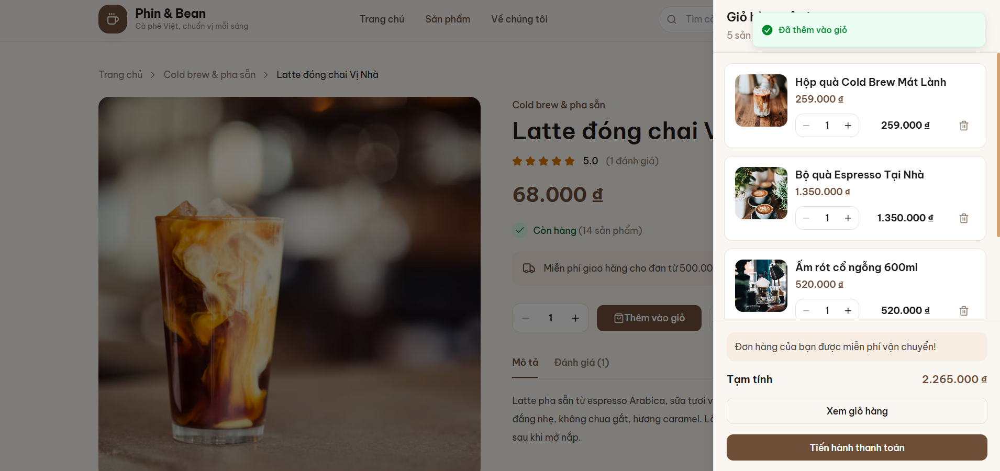
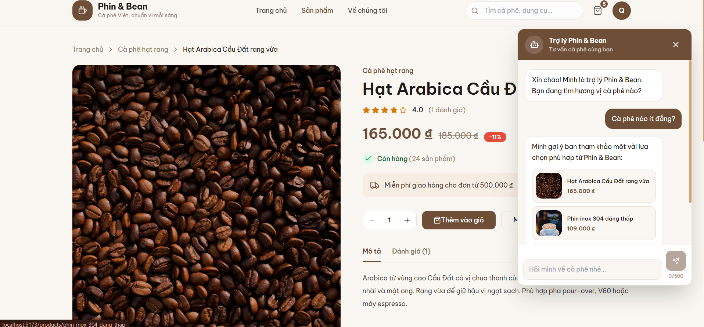
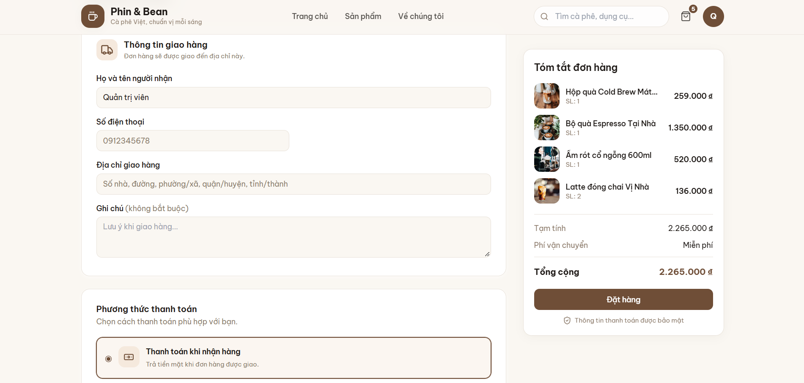

# Phin & Bean

Phin & Bean là cửa hàng cà phê trực tuyến với trải nghiệm mua sắm tiếng Việt, thanh toán mô phỏng và khu vực quản trị riêng.

## Chức năng

### Dành cho khách hàng

- Duyệt danh mục, tìm kiếm, lọc và sắp xếp sản phẩm; xem chi tiết, đánh giá và sản phẩm liên quan.
- Đăng ký, đăng nhập, cập nhật hồ sơ và đổi mật khẩu.
- Giỏ hàng dành cho khách và người dùng đã đăng nhập; đồng bộ giỏ khi đăng nhập.
- Đặt hàng với COD, thẻ mô phỏng hoặc VietQR mô phỏng; theo dõi và hủy đơn theo điều kiện.
- Xem lịch sử đơn hàng và đánh giá sản phẩm đã mua, nhận hàng.
- Chatbot tư vấn cà phê bằng Gemini; tự chuyển sang chế độ tìm sản phẩm dự phòng nếu không cấu hình được Gemini.

### Dành cho quản trị viên

- Dashboard doanh thu, đơn hàng, khách hàng và tồn kho.
- Quản lý sản phẩm, danh mục, ảnh, đơn hàng và khách hàng.
- Theo dõi đơn và chuyển trạng thái theo quy tắc nghiệp vụ.

## Công nghệ và kiến trúc

- Frontend: React, TypeScript, Vite, Tailwind CSS, React Router, TanStack Query, Zustand.
- Backend: FastAPI, SQLAlchemy, Alembic, SQLite.
- Chatbot: Google Gemini qua `google-genai`.



## Cấu trúc thư mục

```text
backend/
  app/                 API, models, schemas, services và seed
  alembic/             Migration cơ sở dữ liệu
  static/uploads/      Ảnh tải lên
  requirements.txt
frontend/
  src/                 Giao diện, API client, component và state
  public/               Ảnh tĩnh và favicon
docs/screenshots/       Ảnh chụp màn hình để bổ sung
run-dev.ps1             Mở backend và frontend trong hai cửa sổ PowerShell
```

## Cài đặt trên Windows

Yêu cầu Python 3.12 trở lên và Node.js 18 trở lên.

### 1. Cài đặt và cấu hình backend

Mở PowerShell tại thư mục gốc dự án:

```powershell
Set-Location .\backend
python -m venv venv
.\venv\Scripts\Activate.ps1
python -m pip install -r requirements.txt
Copy-Item .env.example .env
```

Mở `backend\.env`, điền `GEMINI_API_KEY` để bật Gemini (có thể để trống để dùng chatbot dự phòng). Sau đó, trong thư mục `backend` và môi trường ảo đã kích hoạt, chạy:

```powershell
python -m alembic upgrade head
python -m app.db.seed
python -m app.db.create_admin
python -m uvicorn app.main:app --reload
```

Backend mặc định chạy tại `http://127.0.0.1:8000`; tài liệu API Swagger tại `http://127.0.0.1:8000/docs`.

### 2. Cài đặt frontend

Mở một cửa sổ PowerShell khác tại thư mục gốc:

```powershell
Set-Location .\frontend
npm install
npm run dev
```

Frontend mặc định chạy tại `http://localhost:5173`.

### Chạy nhanh

Từ thư mục gốc, chạy:

```powershell
.\run-dev.ps1
```

Script mở backend và frontend trong hai cửa sổ PowerShell riêng. Để dừng, đóng hai cửa sổ đó.

## Tài khoản và thanh toán demo

| Vai trò | Email | Mật khẩu |
|---|---|---|
| Quản trị viên | `admin@shop.com` | `Admin@123` |
| Khách hàng mẫu | `khach1@phinbean.example` | `PhinBean@123` |

Thẻ mô phỏng:

- `4242 4242 4242 4242`: thanh toán thành công.
- `4000 0000 0000 0002`: giao dịch bị từ chối.

Chatbot vẫn tư vấn bằng chế độ dự phòng khi chưa có API key Gemini hoặc Gemini tạm thời không khả dụng.

## Ảnh chụp màn hình

Lưu ảnh tại `docs/screenshots/`, sau đó thay các dòng ghi chú dưới đây bằng ảnh thực tế:

### Trang chủ


### Danh mục


### Danh sách sản phẩm


### Giỏ hàng


### Chatbot tư vấn AI


### Thanh toán


## API chính

Các endpoint quản trị yêu cầu quyền admin. Endpoint có dấu `*` yêu cầu đăng nhập; endpoint tạo đánh giá chỉ cho phép người dùng đủ điều kiện theo lịch sử đơn hàng.

| Phương thức | Đường dẫn | Mô tả | Quyền |
|---|---|---|---|
| GET | `/api/health` | Kiểm tra trạng thái API | Công khai |
| POST | `/api/auth/register` | Tạo tài khoản khách hàng | Công khai |
| POST | `/api/auth/login` | Đăng nhập, nhận access token | Công khai |
| GET, PUT | `/api/auth/me` | Xem và cập nhật hồ sơ | Đăng nhập* |
| PUT | `/api/auth/change-password` | Đổi mật khẩu | Đăng nhập* |
| GET | `/api/categories` | Danh sách danh mục | Công khai |
| GET | `/api/products` | Tìm kiếm, lọc và phân trang sản phẩm | Công khai |
| GET | `/api/products/{slug}` | Chi tiết sản phẩm | Công khai |
| GET | `/api/products/{slug}/reviews` | Danh sách và thống kê đánh giá | Công khai |
| GET | `/api/products/{slug}/can-review` | Kiểm tra quyền đánh giá | Đăng nhập* |
| POST | `/api/products/{slug}/reviews` | Tạo/cập nhật đánh giá | Đăng nhập*, người mua đủ điều kiện |
| POST | `/api/chat` | Tư vấn sản phẩm | Công khai, giới hạn tốc độ |
| GET, POST, PUT, DELETE | `/api/cart` và `/api/cart/items/{product_id}` | Xem và quản lý giỏ hàng | Đăng nhập* |
| POST | `/api/cart/merge` | Gộp giỏ khách vào tài khoản | Đăng nhập* |
| POST | `/api/orders` | Tạo đơn hàng từ giỏ | Đăng nhập* |
| GET | `/api/orders/me` | Danh sách đơn của tôi | Đăng nhập* |
| GET | `/api/orders/{code}` | Chi tiết đơn | Chủ đơn hoặc admin |
| POST | `/api/orders/{code}/cancel` | Hủy đơn đủ điều kiện | Chủ đơn |
| GET | `/api/admin/stats` | Thống kê tổng quan | Admin |
| GET | `/api/admin/stats/revenue` | Doanh thu theo ngày | Admin |
| GET | `/api/admin/stats/orders-by-status` | Thống kê đơn theo trạng thái | Admin |
| GET | `/api/admin/stats/top-products` | Sản phẩm bán chạy | Admin |
| GET, POST, PUT, DELETE | `/api/admin/products` | Quản lý sản phẩm | Admin |
| PATCH | `/api/admin/products/{id}/status` | Cập nhật trạng thái sản phẩm | Admin |
| POST | `/api/admin/upload` | Tải ảnh sản phẩm/danh mục | Admin |
| GET, POST, PUT, DELETE | `/api/admin/categories` | Quản lý danh mục | Admin |
| GET, PATCH | `/api/admin/orders` | Danh sách, chi tiết và cập nhật trạng thái đơn | Admin |
| GET | `/api/admin/customers` | Danh sách khách hàng | Admin |

